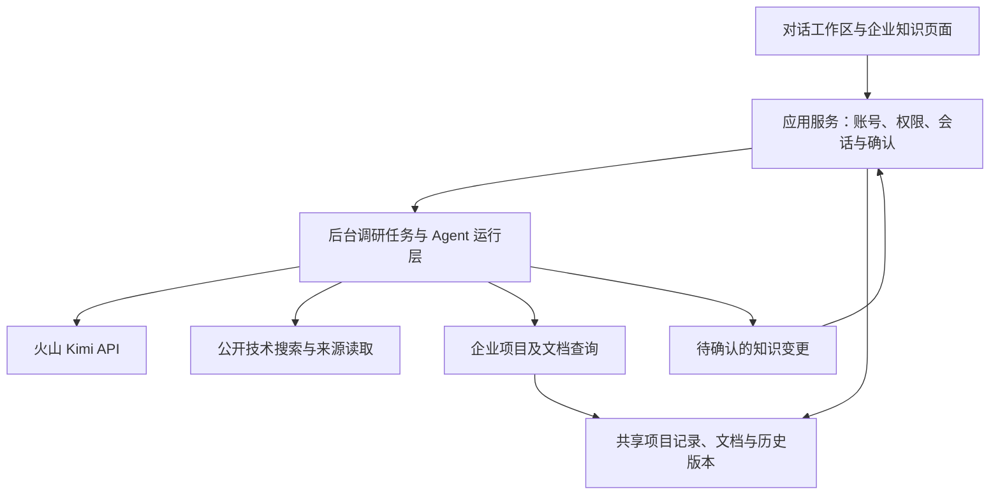

# 企业研发助手首版实现路线

> 实现进度更新（2026-10-29）：用户已授权开始实现。下文保留需求访谈和设计时的事实快照；当前已完成本地实现及测试，Codex/Ark 与真实搜索验证已通过。线上部署、端到端和容量验收以 `docs/implementation-status.md` 及发布结果为准。

历史 `work/` 下的探测脚本和发布产物保留在开发工作区，不作为运行依赖提交。当前可执行的验收入口见 `backend/assistant/management/commands/`。

日期：2026-10-29。本文是依据已确认 Q1–Q15 整理的工程建议，不表示代码已实现、服务已部署或容量已达标。产品需求见 `docs/requirements/2026-10-29-agent-reframing.md`，术语见 `GLOSSARY.md`，路径均相对于源码仓库根目录。

## 推荐方向

保留现有账号、管理员、Django、数据库和 Docker 基础，围绕连续对话重建主流程；以企业项目卡片和依据文档构成共享知识。先验证 Codex 与现有火山 Kimi 的兼容性：通过且集成成本合理时复用其运行层，否则在现有服务内实现范围明确的对话与工具循环。两种路径遵循相同业务权限、资料边界和验收场景。

Codex 官方将可复用部分定位为 Agent 执行循环、会话、事件与工具交互，业务记录和控制仍由宿主产品负责，因此不能直接把开源仓库当成现成的企业知识库网站。[官方说明](https://developers.openai.com/blog/codex-as-a-platform)

现有 Python SDK 通过 JSON-RPC 控制本地 App Server，可作为保留 Django 的候选集成方式；具体版本需在验证后固定。[SDK 文档](https://learn.chatgpt.com/docs/codex-sdk)

## 产品入口建议

| 入口 | 使用方式 | 关键边界 |
| --- | --- | --- |
| 对话工作区 | 描述需求、回答追问、查看进度与芯片对比、继续修正条件 | 个人会话私有；Agent 自行安排搜索与追问 |
| 企业知识 | 上传和检索文档，查看项目卡片、芯片、模块与分工 | 所有登录用户共享已保存知识；普通用户维护自己的贡献 |
| 管理后台 | 保留账号管理，处理跨用户修改、内容冲突和历史追踪 | 不为所有普通用户新增内容设置统一管理员审核 |

知识保存应展示拟保存的项目、模块、芯片、人员、来源和生效时间；用户确认的是具体内容，确认后才成为共享知识。临时搜索结果不会自动成为某项目实际采用的芯片记录。

## 应用与 Agent 的职责

工程上建议将 Agent 能力限定为公开搜索、来源读取、项目查询、文档检索和提出知识变更。权限与最终写入在应用服务检查，不能依赖提示词或模型自行判断；查询工具读取共享知识时也不能取得其他用户的私有会话。企业资料按回答所需片段提供给模型，公网搜索工具只接受必要技术条件，需检查其实际发出的查询内容。

项目、模块、芯片使用与人员职责使用明确关系回答；文档检索负责补充依据和其他项目内容。记录需要同时表达来源、贡献者、历史版本及事实生效时间。同名项目或人员先消歧，历史与当前事实分别查询，冲突保留双方依据供管理员处理。

## Codex 验证与选择条件

当前成功的 Chat Completions 调用不证明 Codex 可接入。官方要求 Responses 行为覆盖流式完成事件、后续轮次的历史输入、工具调用和匹配的工具结果。[兼容要求](https://learn.chatgpt.com/docs/enterprise/gateway-compatibility)

验证分两层：先用无内部资料的受控请求检查 Ark Responses 基础协议；通过后再用固定版本的真实 Codex 客户端完成“追问 → 查询工具 → 继续对话”，检查流式、停止、恢复与多用户会话隔离。前者不能代替后者。

截至本次整理，预检因 DNS 失败停在获取凭据之前，实际推理请求为 0，Codex 客户端测试未运行。准备脚本和脱敏结果分别位于 `work/probe_ark_responses.py` 与 `work/ark-responses-preflight.json`。联网搜索需要单独验证提供方、来源覆盖和额度，不能假设配置第三方模型后自动拥有搜索能力。

选择建议：上述验证通过并满足两条核心流程后优先复用 Codex；如需维护大量协议补丁，采用应用内的轻量运行层，以已确认的火山优先原则为准。不以 fork 整个 Codex 作为默认前置工作。

## 实现与验收顺序

| 阶段 | 交付内容 | 可检查的结果 |
| --- | --- | --- |
| 1. 技术验证 | 模型协议与客户端证据、搜索可用性、实际服务器与额度调查 | 明确运行层选择及原因；记录失败项，不将文本请求成功当作全部兼容 |
| 2. 完整调研链路 | 持久会话、连续追问、联网搜索、来源读取、候选比较、进度与停止 | 完成需求场景 A，条件变更后能继续调研，引用与结论对应 |
| 3. 企业知识链路 | 文档导入、项目卡片、模块与人员关系、历史查询、确认后保存 | 完成需求场景 B，验证知识共享、会话私有、编辑权限与冲突处理 |
| 4. 容量和 Docker 交付 | 代表性资料与并发测试、部署配置、迁移及恢复步骤 | 报告 200 账号、50 同时调研、10,000 份资料条件下的实际结果 |

现有个人选型需求单与企业项目含义不同，迁移时需分别保存，不能因表名同为 Project 就自动合并为企业知识。上线前应盘点实际数据，保留可恢复备份并验证迁移与回退步骤；现有部署状态需要届时重新检查。

## 容量验证建议

目标是 50 人同时进行真实调研，不能仅创建 50 条排队任务后宣称达标。建议将对话请求与调研执行分开，由后台任务承担外部调用，进度和停止指令独立传递；模型、搜索、文档处理分别设置可配置并发限制，任务级限制用于避免单次调研无限占用资源。具体调度实现和限制数值在实测后确定。

测试使用 200 个账号、10,000 份包含代表性页数和表格规模的资料；依次增加并发至 50，验证同时调研时的登录、知识查询、结果隔离和停止行为。分别记录排队时间、首份可用结果时间、完整完成时间、成功/失败/取消数量、外部限流、CPU/内存/数据库负载及模型用量；用分位数报告耗时，不能仅用平均数掩盖长时间等待。

1–3 分钟首份可用结果是已确认的体验目标，尚未承诺所有请求在此时限完成。50 并发所需的火山与搜索额度、服务器资源、单份资料规模仍待核实；若实测不能满足目标，先定位瓶颈并给出有证据的配置或服务选择，不能静默降低目标。

部署继续优先 Docker，项目文件与持久数据限定在 `/data/solexai/yongjun`，镜像与容器运行层可复用已获允许的 `/data/dockerdata`。本轮未修改线上服务。
