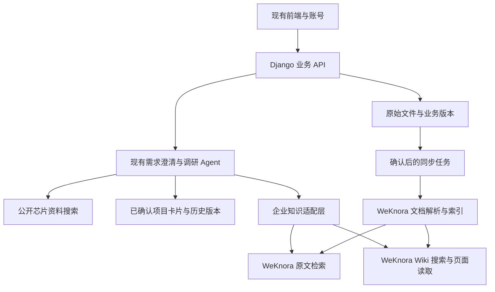

# 企业知识库接入 WeKnora 的替换方案

日期：2026-10-29。本文保留实施前方案基线；首批实现及实际部署约束见 [运行说明](../../deploy/weknora/README.md)。2026-10-30 实测修正：读取 Key 在专用集成租户内仅授予 `retrieve`，不设 KB 白名单，以支持当前版本的文档 ID 限定检索；写入 Key 仍按 KB 限定。下文拟议能力不表示已全部完成。

当前项目基线：`main@41271e2d652b68e681b7532312645f8258cda86d`。WeKnora 基线：已发布的 **v0.9.0**，提交 `f17ee8a8da901bd658a4cb25f40b5fd41adbfdd7`。发布于北京时间 2026-10-29 14:59:12；此前“latest 还是 0.8.3”的结论已过时。镜像标签及 digest 尚未拉取验证。[官方发布](https://github.com/Tencent/WeKnora/releases/tag/v0.9.0)

## 1. 结论与替换边界

建议把 WeKnora 接成现有系统的**知识处理服务**：接管文档解析、索引、混合检索和 Wiki 整理；Django 继续管理账号、个人聊天、项目确认记录、资料版本及发布规则。现有 Agent 调用 WeKnora 的检索 API，自己完成需求追问、工具选择和最终回答。

这是一次知识后台接入，不需要把现有应用整体改写成 WeKnora，也不需要维护两个面向用户的聊天系统。主要工作是版本同步、引用映射和发布状态衔接，不能只将搜索 URL 换掉就视为完成。

| 模块 | 处理方式 | 原因 |
|---|---|---|
| 前端、登录、自助注册、管理员、私人聊天 | 保留 | 用户已经明确采用所有登录用户共享企业知识、个人聊天私有的模式 |
| 多轮澄清、联网芯片调研、现有 Kimi 调用 | 保留 | 企业知识检索只是现有 Agent 的一个工具 |
| 项目卡片、芯片/模块/负责人、确认提案、历史生效时间 | 保留为权威记录 | 自动 Wiki 的发布状态不能替代用户确认；人员分工仍需明确依据 |
| 原始文件、文档 ID、不可变版本、发布/撤回记录 | 保留在 Django | 保持现有引用、审计和历史文件可追溯 |
| 当前 Passage 与 PostgreSQL 全文搜索 | 分阶段替换为 WeKnora 检索 | 先并行对照与可回退，验证后再停用旧索引 |
| Wiki 页面、关系、来源和修订历史 | 新增，复用 WeKnora | 作为资料整理层，辅助理解项目背景 |
| 确认前的文档预览 | 首阶段保留现有解析 | 避免未发布内容进入共享 Wiki；以后再评估隔离暂存库 |

## 2. 当前代码如何接上

当前 `knowledge.py` 的 `retrieve()` 使用 Jieba 分词、PostgreSQL `SearchVector/SearchRank` 检索 `Passage`，只取 `published` 版本；项目范围来自文档直接关联及当前项目卡片中的 `document_ids`。`index_document()` 完成解析和索引后将版本置为 `ready`，用户确认才发布。[当前检索与发布](../../backend/assistant/knowledge.py)

`EnterpriseProject/ProjectVersion/Proposal` 已经承担项目事实、历史版本和提案确认。它们与 `KnowledgeDocument/KnowledgeVersion` 属于业务模型，不能用 WeKnora 的页面表替代。[当前模型](../../backend/assistant/models.py)

推荐改动位置如下；新增名称是设计建议，尚未创建：

| 位置 | 具体改动 |
|---|---|
| `backend/assistant/knowledge.py` | 保留项目与发布业务；将检索委托给 backend adapter；确认/撤回在事务中写入同步事件 |
| 新增 `backend/assistant/knowledge_backends/` | 封装旧检索和 WeKnora 的上传、状态、检索、页面读取、删除等调用；统一返回内部引用结构 |
| `backend/assistant/models.py` + migrations | 增加外部文档版本映射、同步任务、知识库绑定及 Wiki 同步代次；不删除旧字段/表 |
| `backend/assistant/tools.py` | `search_knowledge` 切换 adapter；保留 `query_projects/propose_project`；逐步增加 Wiki 搜索/读取工具 |
| `backend/assistant/views.py`、`urls.py` | 保持现有文档、搜索、下载接口；新增同步状态和受控 Wiki 读取接口 |
| 新增独立同步 worker | 处理上传、轮询、失败恢复、删除和定期对账，避免占用现有对话线程池 |
| `frontend/src/main.tsx` | 保留现有资料页；增加“原文可检索 / Wiki 整理中 / Wiki 失败”状态、Wiki 阅读和来源跳转 |
| Docker 配置 | 新增独立 WeKnora 服务组，复用项目后端镜像运行同步 worker |

当前 `agent_worker` 会在同一线程池领取对话和文档任务。批量导入 1 万份资料不应继续与交互争用这个池；新同步 worker 只负责集成任务，WeKnora 自身负责解析/Embedding/Wiki 队列。[当前 worker](../../backend/assistant/management/commands/agent_worker.py)

## 3. 账号、知识库与检索范围

一个 WeKnora tenant 对应当前企业共享知识。200 个应用账号继续由 Django 管理，不需要复制成 200 个 WeKnora 账号。前端只访问 Django；Django 保存集成密钥，并记录具体业务操作者。建议拆分只读检索 Key 与同步写入 Key，限定允许访问的 KB；建库管理使用独立运维凭据。WeKnora 支持 capability 和 KB 范围，但并不了解本系统的用户、审批及历史版本。[API Key 类型](https://github.com/Tencent/WeKnora/blob/f17ee8a8da901bd658a4cb25f40b5fd41adbfdd7/internal/types/tenant_api_key.go)

建议初始采用**每个项目一个 KB，加一个公共资料 KB**。这是为了控制 Wiki 整理范围和更新影响，不是引入项目成员访问限制：仍然所有登录用户共享。公共规范、通用器件资料放公共库；项目设计与会议纪要放对应项目库。

现有文档可以被多个项目卡片引用，不能简单改成只能属于一个项目。首阶段保留本地多项目引用，原文查询根据项目解析成文档 ID 集合；公共资料不自动重复上传到每个项目。项目 Wiki 是否需要纳入某些公共来源，作为单独的受控同步能力评估，不能假设跨 KB 原文关联会自动生成项目 Wiki。

检索接口采用 `POST /api/v1/knowledge-search`，返回原文片段，无需调用 WeKnora 的聊天接口。Wiki 则采用 `POST /api/v1/wiki-search`，命中后再读取页面详情和来源。[原文检索实现](https://github.com/Tencent/WeKnora/blob/f17ee8a8da901bd658a4cb25f40b5fd41adbfdd7/internal/handler/session/qa.go#L890-L1001)、[Wiki API](https://github.com/Tencent/WeKnora/blob/f17ee8a8da901bd658a4cb25f40b5fd41adbfdd7/internal/router/routes_knowledge.go#L353-L398)

必须遵守以下已经核对的接口语义：

- `knowledge_base_ids` 与 `knowledge_ids` 不是交集；传整库 ID 会将范围扩大到该库。因此按当前发布版本限定时，**只传批准的 knowledge_ids**。集合为空时本地直接返回空结果，不能省略过滤器继续查询。
- 原文搜索没有任意 `project_id/metadata` 过滤；项目范围须由本系统先转换。回包再次核对版本仍处于当前发布状态后，才送入回答模型。
- Wiki 搜索只能按 KB 限定，不能按文档白名单限定。搜索结果还缺完整来源，必须读取页面详情。
- 当前 Wiki 搜索基于页面文本匹配，并非原文向量检索。对长自然语言问题，Agent 应提取项目/实体关键词，再回原文核实；中文召回效果必须试测。

[检索范围构造](https://github.com/Tencent/WeKnora/blob/f17ee8a8da901bd658a4cb25f40b5fd41adbfdd7/internal/application/service/session_knowledge_qa.go#L438-L554)、[Wiki 请求与返回](https://github.com/Tencent/WeKnora/blob/f17ee8a8da901bd658a4cb25f40b5fd41adbfdd7/internal/handler/wiki_page.go#L1121-L1215)、[Wiki 搜索实现](https://github.com/Tencent/WeKnora/blob/f17ee8a8da901bd658a4cb25f40b5fd41adbfdd7/internal/application/repository/wiki_page.go#L1474-L1536)

## 4. 发布、同步、更新与撤回

推荐首阶段工作流：

1. 用户上传到现有系统，保留原文件并私有预览。
2. 用户确认发布；Django 在同一事务保存发布状态及同步任务。
3. 同步 worker 上传到 WeKnora，记录外部 ID，轮询解析和子任务阶段。
4. 原文达到可检索状态后启用原文检索；Wiki 单独显示整理进度。
5. 失败展示原因并允许重试，周期性对账修复遗漏；不把 HTTP 上传成功当作整个入库完成。

建议维护外部绑定：`local_version_id → tenant/kb_id/knowledge_id`，另存内容哈希、目标代次、实际同步代次、原文状态、Wiki 状态、最新 attempt、重试时间和错误。绑定与任务使用唯一约束；上传超时先对账再重试，不能假设第三方接口天然幂等。

业务状态与技术状态分开：`published` 表示用户允许共享，`source_ready` 表示可检索，`wiki_ready` 表示该代资料整理验收通过。它们不能合并成一个“完成”。Wiki 文件级任务重试失败后可能进入 SQL 死信，同时文档总状态晋级 `completed`；需核对最新 attempt 的 `postprocess.wiki` 阶段。[失败归档](https://github.com/Tencent/WeKnora/blob/f17ee8a8da901bd658a4cb25f40b5fd41adbfdd7/internal/application/service/wiki_ingest.go#L1312-L1392)、[文档完成计数](https://github.com/Tencent/WeKnora/blob/f17ee8a8da901bd658a4cb25f40b5fd41adbfdd7/internal/application/repository/knowledge.go#L661-L747)

**确认前不要直接上传正式共享库。** WeKnora Wiki 默认 published，搜索只排除 archived，draft 也可能命中；不能拿它的 draft 实现本项目的私有预览。第一阶段继续使用现有解析预览，因而扫描件/OCR 预览能力不会自动随检索替换而完整升级。若以后需要确认前使用 WeKnora 解析，建立与正式搜索彻底隔离、关闭 Wiki 的暂存 KB，再另行处理转正。[页面默认值](https://github.com/Tencent/WeKnora/blob/f17ee8a8da901bd658a4cb25f40b5fd41adbfdd7/internal/application/service/wiki_page.go#L78-L90)、[搜索状态条件](https://github.com/Tencent/WeKnora/blob/f17ee8a8da901bd658a4cb25f40b5fd41adbfdd7/internal/application/repository/wiki_page.go#L1483-L1533)

**更新/撤回不能只调用 DELETE 或 reparse。** 删除源文档后的 Wiki 清理包含 best-effort 与异步操作；多来源页可能先移除 source_refs，正文稍后才重写。仅检查剩余 source_refs 仍可能放过旧事实。[删除顺序](https://github.com/Tencent/WeKnora/blob/f17ee8a8da901bd658a4cb25f40b5fd41adbfdd7/internal/application/service/knowledge_delete.go#L180-L319)

因此建议：

- 更新/撤回先在 Django 事务中修改当前有效版本，增加受影响 KB 的资料代次并写同步任务；原文允许列表立即去掉旧外部 ID。
- 受影响 KB 的 Wiki 标为待更新，暂不参与回答；其他有效原文照常可查，前端说明 Wiki 整理中。
- 只有能证明当前代次处理完整，才重新启用 Wiki。不能用 DELETE 成功、总 pending=0 或少量关键词抽查作为唯一证明。若试点无法通过现有 API 可靠证明撤回完成，则保持 Wiki 关闭，或在新 KB 代次中从当前有效资料重建后切换；后一方案有重新解析/Embedding/Wiki 的成本。
- 对话使用知识快照代次；长回答交付前再核对所用版本/代次，发现变化则重新检索或提示资料已更新，避免查询途中撤回仍输出旧内容。
- 原文件与历史版本留在 Django，旧回答的历史引用仍可追溯；历史来源展示要标明已归档/撤回，不能再作为当前检索事实。

对于 Wiki SQL 死信，目前没有在公开路由找到专项批量恢复接口。reparse 可间接重触发，但会重复解析和索引。先在试点验证恢复方案，必要时给上游提小补丁；业务服务不直接写 WeKnora 数据表。[恢复代码与接口证据](../research/2026-10-29-weknora-api-evidence.md)

## 5. 回答与引用规则

查询“项目用了什么芯片、各模块是谁负责”时：先查已经确认的项目卡片，再查当前原文证据，Wiki 用于补充背景和定位关联。资料冲突应展示来源与时间并提出更新建议，不能让自动 Wiki 静默覆盖已确认记录。

可将已确认卡片导出为带项目版本/生效日期的 Markdown，送入 WeKnora 辅助关联；更新仍从 Django 的确认流程发起，避免两边分别编辑出两个事实版本。首版不必做卡片自动导出即可完成原文接入。

保留现有 `/api/assistant/documents/{id}/file/?version={version_id}` 引用。适配器将 WeKnora `knowledge_id/chunk_id/source_locators` 映射到本地版本，页码缺失时明确降级到文档/片段引用，不编造定位。Wiki 阅读通过 Django 代理，标注“自动整理”、来源及页面版本；旧引用需要固定版本或保存引用快照，不能永远跳到变化中的最新页面。

首版 Wiki 以阅读、关联与来源跳转为主；用户更正事实仍走现有资料/项目确认流程。后续若开放 Wiki 直接编辑，必须传入读到的 version 并处理 409 冲突，不能省略乐观锁版本。[页面与编辑请求类型](https://github.com/Tencent/WeKnora/blob/f17ee8a8da901bd658a4cb25f40b5fd41adbfdd7/internal/types/wiki_page.go)

按日期查询历史项目仍用现有 `ProjectVersion.effective_from`。当前 Wiki 页面修订时间不等于项目事实的生效时间，首版不宣称支持自动 Wiki 的完整历史事实查询。

## 6. Docker 与模型配置

建议独立 Compose 服务组，配置/数据库/文件/备份放在 `/data/solexai/yongjun/weknora`；Docker 镜像与运行层继续使用已获准复用的公共 Docker 存储。以下为拟议部署，不是已执行变更。

| 服务 | 首阶段用途 |
|---|---|
| WeKnora app | Go API、后台知识任务与 Wiki |
| WeKnora docreader | 文档解析；OCR/多模态能力按资料与模型另验 |
| 独立 ParadeDB PostgreSQL 17 | WeKnora 数据、BM25 和向量索引 |
| Redis | 后台队列与运行协调，显式挂载持久化目录 |
| 可选 WeKnora UI | 内部管理员调试；普通用户仍使用现有前端 |

v0.9.0 标准 Compose 的数据库是 `paradedb/paradedb:v0.25.11-pg17`，当前项目用 `pgvector/pgvector:pg16`，不能共用当前数据卷直接切镜像。标准 app 依赖数据库、Redis、docreader；本地文件存储可以先用，不需要为 Wiki 同时启用 Neo4j、MinIO、Milvus 等选配组件。[固定版本 Compose](https://github.com/Tencent/WeKnora/blob/f17ee8a8da901bd658a4cb25f40b5fd41adbfdd7/docker-compose.yml)、[架构说明](https://github.com/Tencent/WeKnora/blob/f17ee8a8da901bd658a4cb25f40b5fd41adbfdd7/website-docs/02-architecture/01-overview.md)

实施时裁剪端口暴露与不需要的服务，避免占用现有 8080；通过内部 Docker 网络访问。镜像锁定实际可获取的版本与 digest。显式配置 Redis `/data` 持久化（上游 Compose 该段未声明持久化挂载），并纳入数据库、文件、映射任务及 `SYSTEM_AES_KEY` 的备份恢复验证。知识功能不需要为应用挂载宿主 Docker socket。

模型需要分开安排：

- **聊天/Wiki**：先验证现有 Ark `kimi-k3-1-pro-261024` 的 Wiki 提取与合并、结构化结果、长文和重试；现有 Agent 能调用成功不等于 WeKnora 所有任务已经兼容。保留已验证的 provider 参数，并检查 WeKnora 的实际请求。
- **Embedding**：必须另配实际可用的向量模型、维度和额度，并验证批量入库；不能直接把 Kimi 聊天 Model ID 填入。以后更换模型/维度需要重建索引计划。
- **Rerank**：可作为质量优化项，在基础召回稳定后启用。WeKnora 的火山 Rerank provider 走 VikingDB 知识库 AK/SK 签名，不能假设现有 Ark Bearer Key 通用。[火山 provider](https://github.com/Tencent/WeKnora/blob/f17ee8a8da901bd658a4cb25f40b5fd41adbfdd7/internal/models/providers/volcengine.go)

50 人调研与资料批处理应分别设并发预算。WeKnora 的模型并发闸门只约束自身后台任务，不覆盖现有 Django Agent，也不约束它自己的交互请求；仍需结合供应商 RPM/TPM 配额控制总负载。不同 Key 不一定有独立额度。[模型并发说明](https://github.com/Tencent/WeKnora/blob/f17ee8a8da901bd658a4cb25f40b5fd41adbfdd7/website-docs/03-features/06-models.md#并发与限流-limiter)

## 7. 迁移顺序与完成条件

| 阶段 | 工作 | 通过条件 |
|---|---|---|
| 0：独立原型 | 固定版本 Docker、服务 Key、聊天和 Embedding；跑真实 API 合同测试 | 文件/正文上传、阶段轮询、原文检索、Wiki、删除/恢复可观察；密钥不进入前端 |
| 1：原文替换 | adapter、版本映射、事务同步任务、引用代理；旧索引保留 | 同一批资料可在两个后端对照；仅当前确认版本可检索；来源映射正确 |
| 2：代表性试点 | 3 个真实项目、30–50 份资料；测试 PDF/Office/表格/中文型号 | 芯片、负责人、冲突和历史问题可核对；预览草稿不进入共享结果 |
| 3：Wiki 接入 | 项目 KB、页面阅读、来源/代次校验、更新撤回和失败恢复 | 多来源撤回与模型失败时不继续回答过期资料；Wiki 失败不会显示为完成 |
| 4：容量与费用 | 扩到 1 万份资料、200 账号、50 人调研，同时注入入库负载 | 记录召回/事实质量、P50/P95、模型限流、队列积压、恢复时间、索引及 Wiki 费用；达到约定目标 |
| 5：切换 | 后端开关切到 WeKnora，继续对账；保留回退窗口 | 回滚演练成功、备份可恢复，再停止旧索引写入并后续清理 |

配置开关可采用 `legacy / shadow / weknora`。shadow 不改变用户回答，仅比较检索结果；对内部资料和模型费用的使用须与试点范围一致。回退必须保证旧索引跟上最新发布/撤回状态；不能以“可回退”为名恢复已经失效的知识。

验收应特意覆盖以下反例，而非只测试上传成功：

1. 未确认草稿、归档版本、撤回资料、别人的私有对话均不会进入企业检索上下文。
2. 同时传 KB/文档导致范围扩大的错误被 adapter 合同测试拦住；空白名单不会查全库。
3. A/B 项目共享一份资料，原文限定正确；项目 Wiki 不混入未选择项目的叙述。
4. 上传响应丢失、worker 重启、重复同步不会产生不可控重复文档；映射可恢复。
5. 多来源 Wiki 撤回、模型 429/超时、Wiki SQL 死信、旧任务晚到，均不把旧代次标为最新。
6. 来源可跳回准确业务版本；无页码时不伪造页码；历史卡片查询不被当前 Wiki 替代。
7. WeKnora 不可用时现有登录、私人聊天和公开芯片调研仍可用；知识工具明确报告当前不可用或经验证的旧索引结果，不编造知识回答。

不据源码或项目热度承诺 1 万份资料/50 并发性能。本次没有服务器资源测量、模型兼容实测或成本数据；这些是第 0–4 阶段的输出。API 请求中 1 万文档允许列表的体积、过滤吞吐和 KB 划分，也需实测后决定是否进一步分批或采用更严格的库代次切换。

## 8. 首批实现范围

建议下一个开发批次只完成 **独立 Docker + 模型验证 + 已确认文档同步 + 原文检索/引用 + 可回退开关**。这一批已经能替换当前知识检索基础；随后再打开自动 Wiki，避免在尚未验证同步与撤回时一次切换全部知识行为。

首版无需复制 WeKnora 前端、用户体系、Agent 会话或图数据库；也无需立即开放 Wiki 直接编辑、历史事实推理、全自动批量恢复和外部企业系统同步。上述能力有明确需求或试点证据后再扩展。

详细 API、固定源码行号和已核对的异常语义见 [WeKnora v0.9.0 API 接入证据](../research/2026-10-29-weknora-api-evidence.md)。
